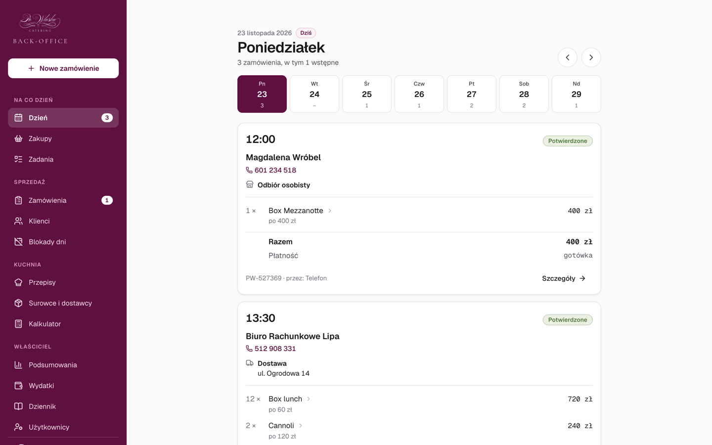

# Krzysztof Jesień

Senior full-stack engineer · 10+ years · TypeScript end to end.
Warsaw, Poland (CET) · remote · English & Polish.

### What I do
- **Senior capacity for agencies and software houses**: white-label or embedded in your team, from first commit to production.
- **AI in real workflows**: LLM integrations, RAG on PostgreSQL + pgvector, MCP servers, OAuth-based ingestion from Gmail, Calendar, Drive and Telegram. I deliver through an AI-assisted SDLC built on Claude Code, and a human signs off on architecture, security and production changes.
- **Web3**: EVM dApps (Wagmi, Viem, Ethers.js), Subgraphs on The Graph, Solidity, Solana, IPFS and Arweave.
- **Custom business software**: internal systems and integrations for 5–100-person companies.

### Experience
- **SSV Labs** (2024–2026): data-ingestion services, RAG pipeline and MCP-connected services for an AI productivity platform; earlier, full-stack Web3 apps (Next.js, NestJS, The Graph).
- **Koii Network** (2021–2023): On-chain UI Lead of a 5-person team; Electron node app and wallet reaching 100k+ users and 50k+ running nodes.
- **Emerson** (2023–2024): Angular/NgRx UI for industrial sensor-network monitoring.
- Earlier: banking, car sharing and clean-energy financing (Hyperledger Fabric) at ITDS, Accenture and Oracle Maxymiser.

### Stack
- **Core:** TypeScript · React · Next.js · Node.js · NestJS · PostgreSQL
- **Also:** Angular · Vue · Electron · Astro · GraphQL · Tailwind · TanStack
- **AI:** LLM APIs · RAG · pgvector · MCP · Claude Code
- **Web3:** Solidity · Hardhat · Foundry · Wagmi · Viem · The Graph · Solana
- **Infra & tests:** Cloudflare Workers & D1 · AWS · GCP · Docker · GitHub Actions · Vitest · Playwright

### Recent work
**Po Włosku**: website, online shop and back-office POS (orders, recipes, shopping lists) for a food business, with a Claude MCP server on top. 37% of orders now come through the site, and it costs $0/month to run. The code is private. See it live at [powlosku.pl](https://powlosku.pl).

### Currently
Available now for agency and Web3 engagements, remote or Warsaw.
Certified: AI_devs 4 Builders (2026) · AI_devs 3 Agents (2025).

### Contact
[LinkedIn](https://www.linkedin.com/in/krzysztof-jesien)
